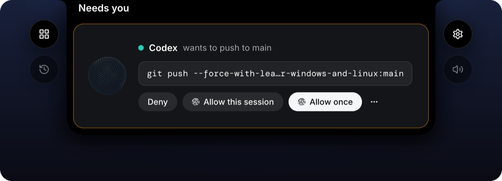
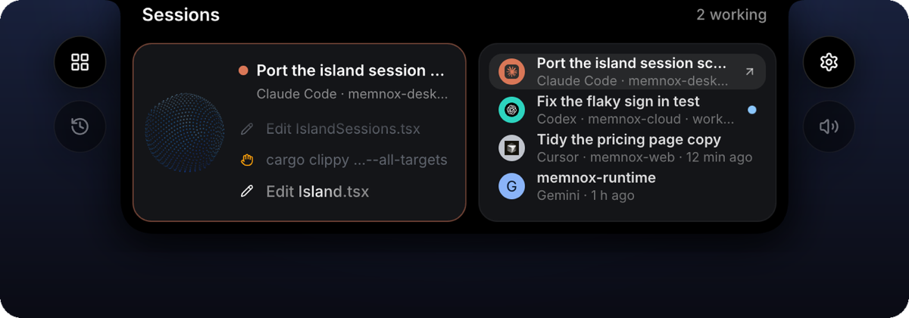
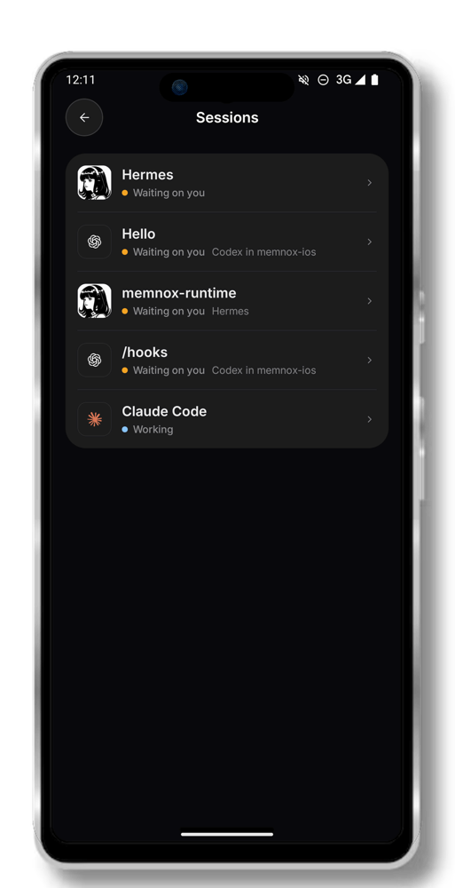
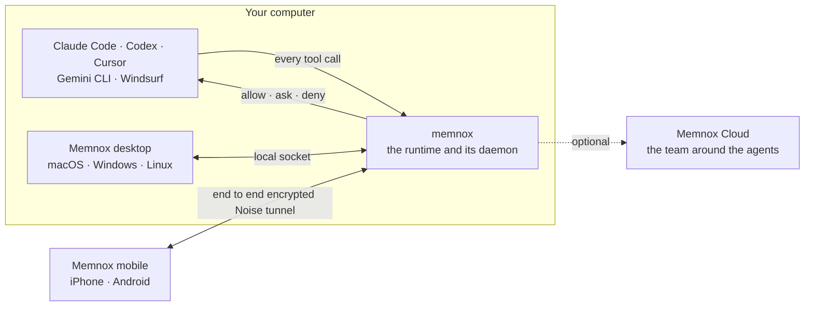

<div align="center">

<picture>
  <source media="(prefers-color-scheme: dark)" srcset="images/memnox-mark-white.png">
  
</picture>

# Memnox

### Your agents can already do the work.<br>Memnox makes it safe to let them **do it without you**.

The control plane for autonomous work: one policy and execution layer above<br>
Claude Code, Codex, Cursor and the rest, with a face on every screen you carry.

<p>
  &nbsp;&nbsp;
  &nbsp;&nbsp;
  &nbsp;&nbsp;
  &nbsp;&nbsp;
  &nbsp;&nbsp;
  
</p>

<p>
  <a href="https://github.com/Memnox/memnox-desktop/tree/main/macos"></a>
  <a href="https://github.com/Memnox/memnox-desktop/tree/main/windows"></a>
  <a href="https://github.com/Memnox/memnox-desktop/tree/main/linux"></a>
  <a href="https://github.com/Memnox/memnox-mobile/tree/main/ios"></a>
  <a href="https://github.com/Memnox/memnox-mobile/tree/main/android"></a>
</p>

[Website](https://memnox.com) · [Docs](https://docs.memnox.com) · [Runtime](https://github.com/Memnox/memnox-runtime) · [Desktop](https://github.com/Memnox/memnox-desktop) · [Mobile](https://github.com/Memnox/memnox-mobile)

<br>


<sub>One run, one question. The agent works on its own, the screen and the phone ask once, and a signed yes releases it.</sub>

</div>

---

Most people never let an agent run unattended, and the reason is not that it cannot do the
work. It is that nobody can say in advance what it will touch. Memnox answers that before every
tool call, so the question stops being *"what did my agent do?"* and becomes
***"what can I safely let it do next?"***

## How it works

1. **Every tool call is ruled on.** The runtime sits inside the session your agent already works
   in and answers each call with one of three verdicts: **allow**, **ask** or **deny**.
2. **What needs a person finds you.** It reaches you in the agent's own prompt, in the island at
   the top of your Mac, Windows or Linux screen, or on your iPhone or Android phone.
3. **Every yes is signed.** Allow goes through Touch ID, Windows Hello, Face ID or a fingerprint,
   and is signed by a key your device guards. Deny needs nothing.
4. **Everything is on the record.** What each agent did is kept, so a session that went wrong
   can be explained and rewound.

No model decides anything, and your code and your secrets never leave your machine.

## On every screen you carry

<table>
<tr>
<td width="64%" valign="top"></td>
<td width="36%" valign="top"></td>
</tr>
<tr>
<td valign="top"><b>macOS.</b> The island grows out of the notch to hear you, answer out loud, show every working session and ask about a held call, with Touch ID on every allow.</td>
<td valign="top"><b>iPhone.</b> The same call waits in the Dynamic Island and on the lock screen, and goes through Face ID.</td>
</tr>
<tr>
<td valign="top"><br><br><br><br><b>Windows and Linux.</b> The same island, the same three answers and the same voice, built screen for screen from the Mac and signed after Windows Hello or a polkit check.</td>
<td valign="top"><br><br><b>Android.</b> Every session on your computer, what needs you and the voice, with the fingerprint on every remote yes.</td>
</tr>
</table>

A held call is one question wherever it is asked. The terminal, the island and the phone all
answer the same call, and whichever answers first releases the agent.

## Open source

| Repository | What it is | Built with | License |
|---|---|---|---|
| **[memnox&#8209;runtime](https://github.com/Memnox/memnox-runtime)** | The runtime. Sits inside every agent session, rules on every tool call, keeps the record, and rewinds a session that went wrong. | TypeScript, Node 22 | Apache&#8209;2.0 |
| **[memnox&#8209;desktop](https://github.com/Memnox/memnox-desktop)** | The island at the top of the screen on macOS, Windows and Linux. It listens, answers out loud, shows every session and signs every yes. | Swift 6 on Apple frameworks for macOS; Tauri 2, React and Rust for Windows and Linux | MIT |
| **[memnox&#8209;mobile](https://github.com/Memnox/memnox-mobile)** | Your agents in your pocket on iPhone and Android: what waits on you, every session and the voice, from anywhere over an end to end encrypted tunnel. | Swift 6 and SwiftUI for iPhone; Kotlin and Jetpack Compose for Android | MIT |

The apps are previews. Windows and Linux are built and tested in CI, and neither phone app is in
a store yet, so each repository's README says how to install or build it today.

## How they fit together



The runtime is the authority. The apps are a face, a voice and a signing key over it, and none of
them holds a rule of its own. Memnox Cloud is added on top once there is a second person, and the
runtime keeps enforcing when it cannot be reached.

## Slack, Gmail and the rest, in your name


Sign in to Slack, Gmail, GitHub, Linear, Google Docs or Notion once, and the apps can work in
them for you. Say *"tell #eng the deploy is out and thank Bo"*, or let an agent propose a reply,
and it arrives as a draft: which account it goes out as, who it goes to, and the exact words in a
box you can change. Nothing goes out until you press **Send**, and Send is signed. **Decline**
needs nothing.

## Start in two commands

```sh
npm install -g memnox
memnox setup
```

`setup` finds the agents on your machine and goes through them one at a time: what each can
already reach, what to call it, and whether to put it under Memnox. Then open your agent the way
you always do. There is nothing to launch and nothing to remember.

## Memnox Cloud

Memnox on your machine governs the agent. **Memnox Cloud** governs the team around it: one fleet
across every laptop, server and pipeline, approvals your team can answer from Slack or Discord,
the decisions your team has settled put in front of every agent, and one record of what every
agent did. It is hosted, it needs no change to how anybody works, and it starts free at
[memnox.com](https://memnox.com).

## Contributing

Pull requests are welcome in all three open source repositories. Each README says how to build
and test the code there, and CI runs those tests on every pull request. If you are unsure where
something belongs, open an issue and ask, because that is a good first contribution too.

<div align="center">
<br>
<sub>Memnox is not another agent. It never writes the code and never does the work. It decides how much of it your agents may do on their own.</sub>
<br><br>
<a href="https://memnox.com">memnox.com</a> · <a href="https://docs.memnox.com">Docs</a> · <a href="https://github.com/Memnox/memnox-runtime">Runtime</a> · <a href="https://github.com/Memnox/memnox-desktop">Desktop</a> · <a href="https://github.com/Memnox/memnox-mobile">Mobile</a>
</div>
