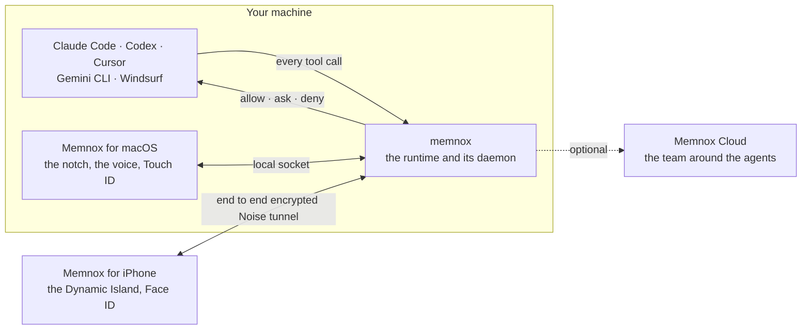

<div align="center">

<picture>
  <source media="(prefers-color-scheme: dark)" srcset="images/memnox-mark-white.png">
  
</picture>

# Memnox

### Let AI agents work autonomously.<br>Keep their actions within your **boundaries**.

The control plane for autonomous work: one policy and execution layer above<br>
Claude Code, Codex, Cursor and the rest, on your laptop, your Mac and your iPhone.

<p>
  &nbsp;&nbsp;
  &nbsp;&nbsp;
  &nbsp;&nbsp;
  &nbsp;&nbsp;
  &nbsp;&nbsp;
  
</p>

[Website](https://memnox.com) · [Docs](https://docs.memnox.com) · [Runtime](https://github.com/Memnox/memnox) · [macOS](https://github.com/Memnox/memnox-macos) · [iPhone](https://github.com/Memnox/memnox-ios)

<br>



<sub>One run, one question. The agent works on its own, the notch and the phone ask once, and Face ID releases it.</sub>

</div>

---

Most people never let an agent run unattended, and the reason is not that it cannot do the
work. It is that nobody can say in advance what it will touch. Memnox answers that question
before every tool call, with one of three verdicts: **allow**, **ask** or **deny**. What is
allowed goes ahead, what is denied is refused with a way forward, and what needs a person
reaches you wherever you are: in the agent's own prompt, in the notch on your Mac, or on your
iPhone's lock screen.

No model decides anything, your code and your secrets never leave your machine, and every
yes that lets an agent act is signed by a key that never leaves a Secure Enclave.

## Open source

| Repository | What it is | Built with | License |
|---|---|---|---|
| **[memnox](https://github.com/Memnox/memnox)** | The runtime. Sits inside every agent session, rules on every tool call, keeps the record, and rewinds a session that went wrong. | TypeScript, Node 22 | Apache-2.0 |
| **[memnox-macos](https://github.com/Memnox/memnox-macos)** | Memnox for macOS. An island in your notch that listens, answers out loud, shows every session and asks with Touch ID. | Swift 6, Apple frameworks only | MIT |
| **[memnox-ios](https://github.com/Memnox/memnox-ios)** | Memnox for iPhone. The Dynamic Island, the lock screen and the same voice, with Face ID on every remote yes. | Swift 6, Live Activities | To be announced |

## How they fit together



The runtime is the authority. The two apps are a face, a voice and a signing key over it, and
neither holds a rule of its own. Memnox Cloud is added on top once there is a second person,
and the runtime keeps enforcing when it cannot be reached.

## The notch and the phone

<table>
<tr>
<td width="64%" valign="top"></td>
<td width="36%" valign="top"></td>
</tr>
<tr>
<td valign="top"><b>On the Mac</b>, the island grows out of the notch to hear you, answer out loud, show every working session with its latest steps, and ask about a held call with Deny, Allow this session and Allow once.</td>
<td valign="top"><b>On the iPhone</b>, the same call waits in the Dynamic Island, opens with Deny and Allow, and goes through Face ID.</td>
</tr>
</table>

A held call is one question wherever it is asked. The terminal, the notch and the phone all
answer the same call, and whichever answers first releases the agent.

## Slack, Gmail and the rest, in your name


Sign in to Slack, Gmail, GitHub, Linear, Google Docs or Notion once, and the apps can work in
them for you. Say *"tell #eng the deploy is out and thank Bo"* to the notch, or let an agent
propose a reply, and it arrives as a draft: which account it goes out as, who it goes to, and
the exact words in a box you can change. Nothing goes out until you press **Send**, and Send is
signed with Touch ID on the Mac or Face ID on the phone. **Decline** needs nothing.

## Start in two commands

```sh
npm install -g memnox
memnox setup
```

`setup` finds the agents on your machine and goes through them one at a time: what each can
already reach, what to call it, and whether to put it under Memnox. Then open your agent the way
you always do. There is nothing to launch and nothing to remember.

## Memnox Cloud

Memnox on your machine governs the agent. **Memnox Cloud** governs the team around it: one fleet
across every laptop, server and pipeline, approvals your team can answer from Slack or Discord,
the decisions your team has settled put in front of every agent, and one record of what every
agent did. It is hosted, it needs no change to how anybody works, and it starts free at
[memnox.com](https://memnox.com).

## Contributing

Pull requests are welcome in all three open source repositories. Each has a `CONTRIBUTING.md`
saying how a change lands, an architecture document saying where new code goes, and a test
suite that has to pass on every commit. If you are unsure where something belongs, open an
issue and ask; that is a good first contribution too.

<div align="center">
<sub>Memnox is not another agent. It never writes the code and never does the work. It decides how much of it your agents may do on their own.</sub>
</div>
